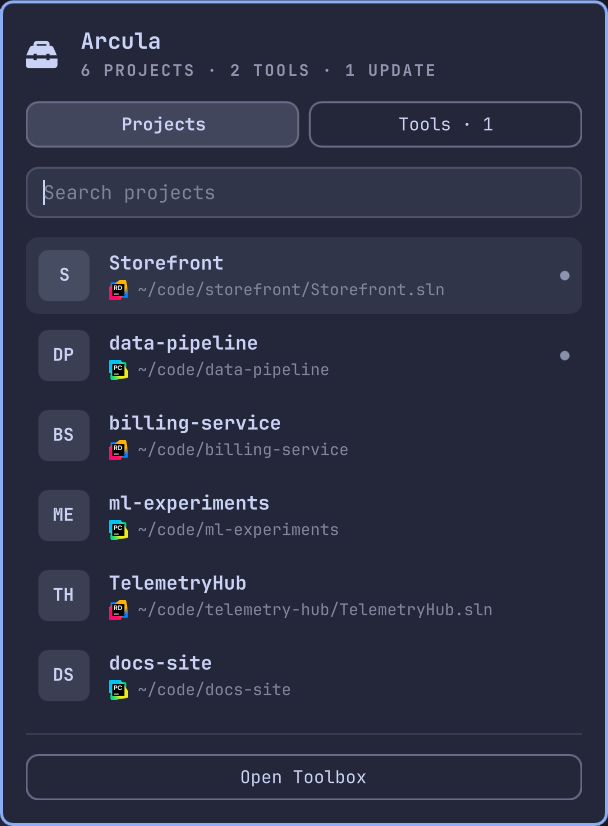
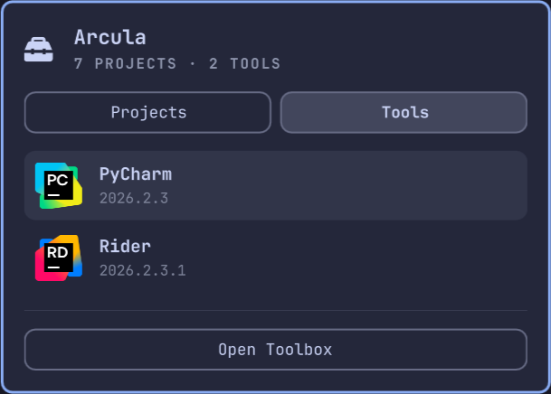

<div align="center">

<picture>
  <source media="(prefers-color-scheme: dark)" srcset="assets/arcula-wordmark.svg">
  
</picture>

**Quick access to your JetBrains Toolbox projects and IDEs from the Omarchy bar.**

[](manifest.json)
[](https://plugins.omarchy.org/)
[](#trademarks)
[](LICENSE)


</div>

Arcula is a bar widget for [Omarchy](https://omarchy.org/).
It lists the recent projects of all your JetBrains IDEs in one panel, opens them in the right IDE, and tells you when an IDE has an update waiting.

It is a community plugin.
It is not affiliated with, endorsed by, or supported by JetBrains.

<table align="center">
  <tr>
    <td align="center" valign="top">
      
      <br>
      <sub>Projects, from every IDE in one list</sub>
    </td>
    <td align="center" valign="top">
      
      <br>
      <sub>Tools, the installed IDEs and their versions</sub>
    </td>
  </tr>
</table>

## What it does

- Lists the recent projects of all your JetBrains IDEs in one panel and opens them in the right IDE.
- Lists the installed IDEs with their versions and launches them.
- Filters projects as you type.
- Hints at pending IDE updates in the bar and in the panel.
- Opens the real Toolbox window for everything else.

It does not replace JetBrains Toolbox.
Login, installing, updating, and settings stay in the Toolbox app.

## Requirements

- Omarchy with the Quickshell-based shell (developed on Omarchy 4.0.4).
- JetBrains Toolbox with at least one IDE installed through it.
- `python3`, standard library only.

## Install

```bash
omarchy plugin add https://github.com/goldbarth/omarchy-arcula --enable
```

Move the widget if you want it elsewhere in the bar:

```bash
omarchy bar move goldbarth.arcula --section right
```

## Usage

| Where | Input | Action |
|---|---|---|
| Bar icon | Left click | Toggle the panel |
| Bar icon | Right click | Open the Toolbox window |
| Projects | Type | Filter by name or path |
| Projects | `Up` / `Down`, `Ctrl+K` / `Ctrl+J` | Move the cursor |
| Projects | `Enter` | Open the project in its IDE |
| Projects | `Esc` | Clear the search, then close |
| Projects | `Right` on an empty search | Switch to Tools |
| Tools | `j` / `k` | Move the cursor |
| Tools | `Enter` | Launch the IDE |
| Tools | `h` or `/` | Switch to Projects |
| Tools | `r` | Check for updates now |
| Both | `Tab` | Move to the neighboring bar panel |

A dot at the end of a project row marks a project that its IDE currently has open.

The panel can also be driven over IPC, for example from a keybinding:

```bash
omarchy-shell goldbarth.arcula toggle
```

## Update hint

When an installed IDE is behind the latest release, the bar icon switches to the accent color, the Tools tab shows a count, and the tool row reads `2026.2.2 → 2026.2.3`.
The hint is informational.
Run the update in the Toolbox app.

To know the latest release, the plugin asks the public JetBrains release feed at `data.services.jetbrains.com`.
This is the only network access the plugin makes.
The request contains the product codes of your installed IDEs and nothing else.
It runs at most once every six hours, or when you press `r` in the Tools tab.
Only the release channel is checked, so EAP builds never show a hint.

## How it works

JetBrains Toolbox has no public API for this, so the plugin reads the files that Toolbox and the IDEs keep on disk.
It never writes to them.

| Data | Source |
|---|---|
| Installed IDEs | `~/.local/share/JetBrains/Toolbox/state.json` |
| Recent projects | `~/.config/JetBrains/*/options/recentProjects.xml` and `recentSolutions.xml` |
| Hidden projects | `~/.local/share/JetBrains/Toolbox/.settings.json` |
| IDE icons | `~/.local/share/JetBrains/Toolbox/dotDesktopIcons/` |
| Latest releases | `~/.cache/goldbarth.arcula/updates.json` |

`collect.py` turns these into one JSON snapshot each time the panel opens.
`Panel.qml` draws it.
IDEs are started through `uwsm-app`, like every other Omarchy launcher.

## Limitations

- These file formats are private to JetBrains and can change with any Toolbox or IDE update.
  If a source goes missing, the panel says which one instead of failing silently.
- Developed and tested on one machine with Toolbox 3.8.1, Rider, and PyCharm.
  Other IDEs should work but are untested.
- The Toolbox binary is looked up in `/opt/jetbrains-toolbox`, in `~/.local/share/JetBrains/Toolbox/bin`, and on `PATH`.
  Without it, the "Open Toolbox" button is hidden.
- Remote and SSH projects are not listed.
- The plugin runs unsandboxed with your user permissions, like every Omarchy shell plugin.
  Read the two source files before you install it.

## Uninstall

```bash
omarchy plugin remove goldbarth.arcula
rm -rf ~/.cache/goldbarth.arcula
```

The second line removes the cached release data, which the plugin manager does not know about.

## Trademarks

JetBrains, JetBrains Toolbox, Rider, PyCharm, and their logos are trademarks of JetBrains s.r.o.
They are named here only to describe what this plugin works with.
The plugin ships no JetBrains assets.
The IDE icons in the panel and in the screenshot are read from your local Toolbox installation.

---

> *Arcula* (Latin) - "a small box". Which is what this is, next to the Toolbox.

## License

Licensed under the [MIT License](LICENSE). © 2026 Felix Wahl.

Related: [Chartula](https://github.com/goldbarth/chartula), a grounded changelog CLI in .NET, and [goldbarth.dev](https://www.goldbarth.dev/), where the experiments behind my projects are written up.
